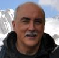
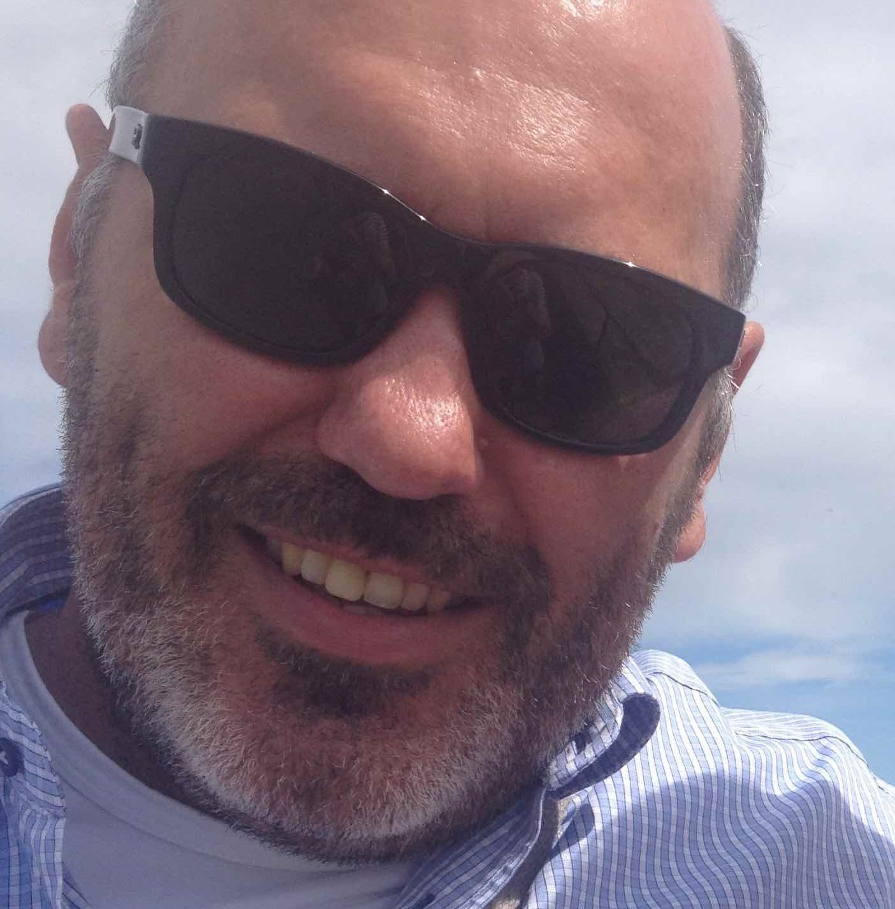
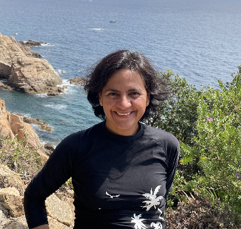
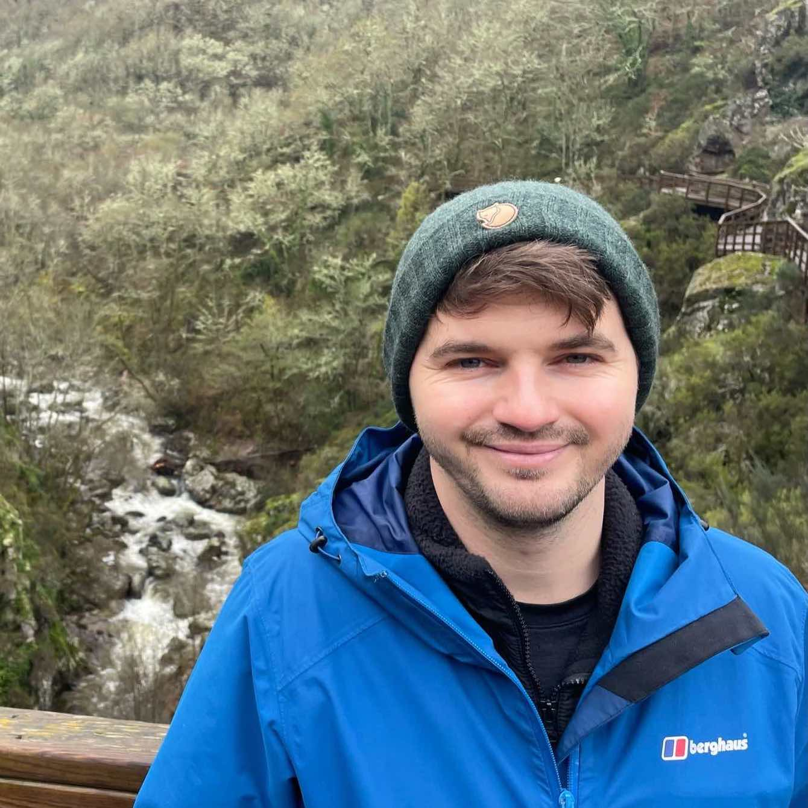
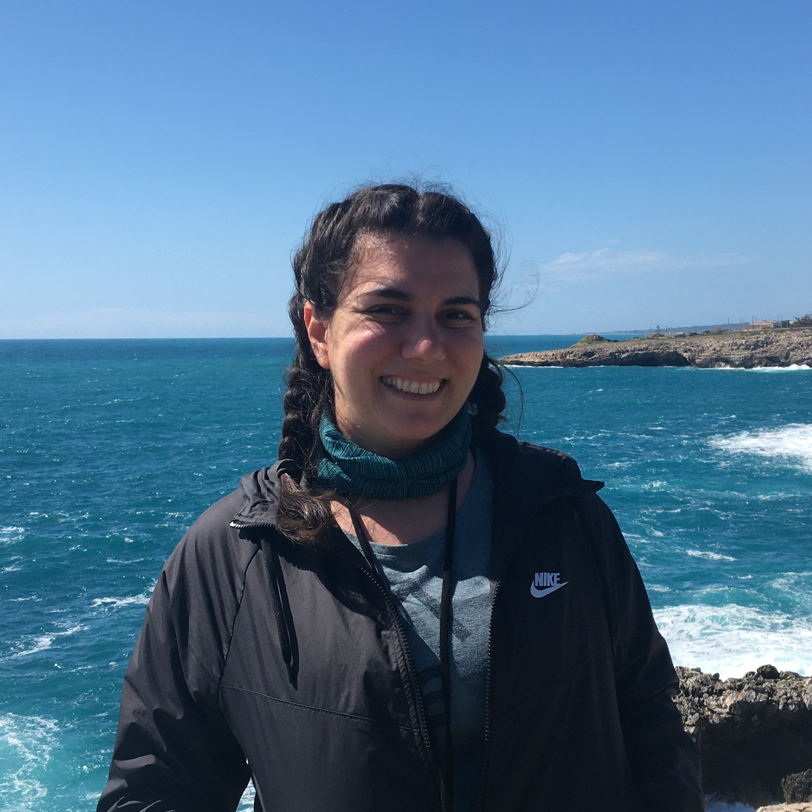
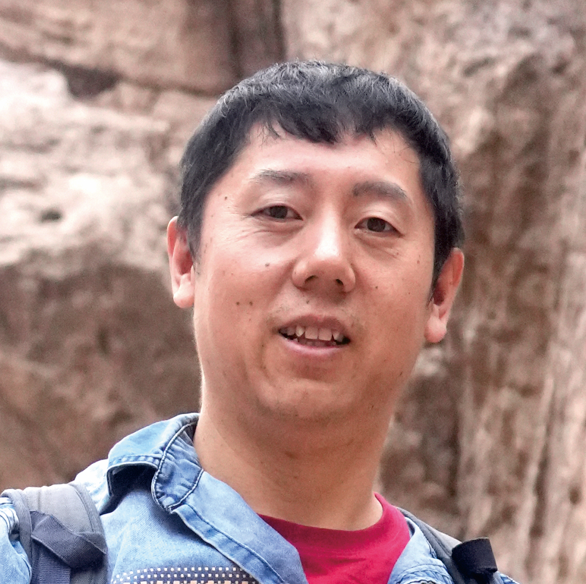
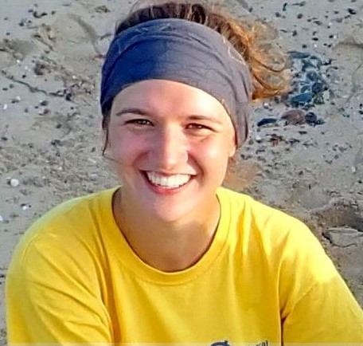
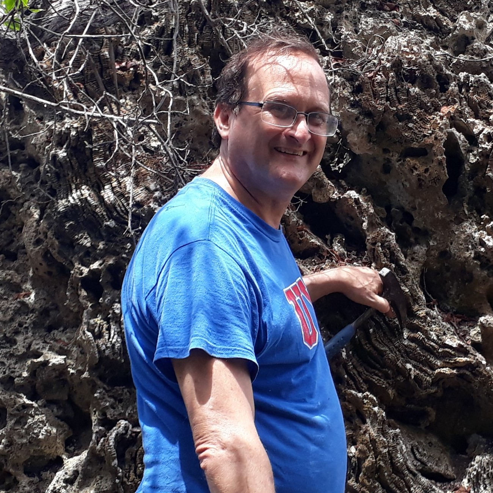
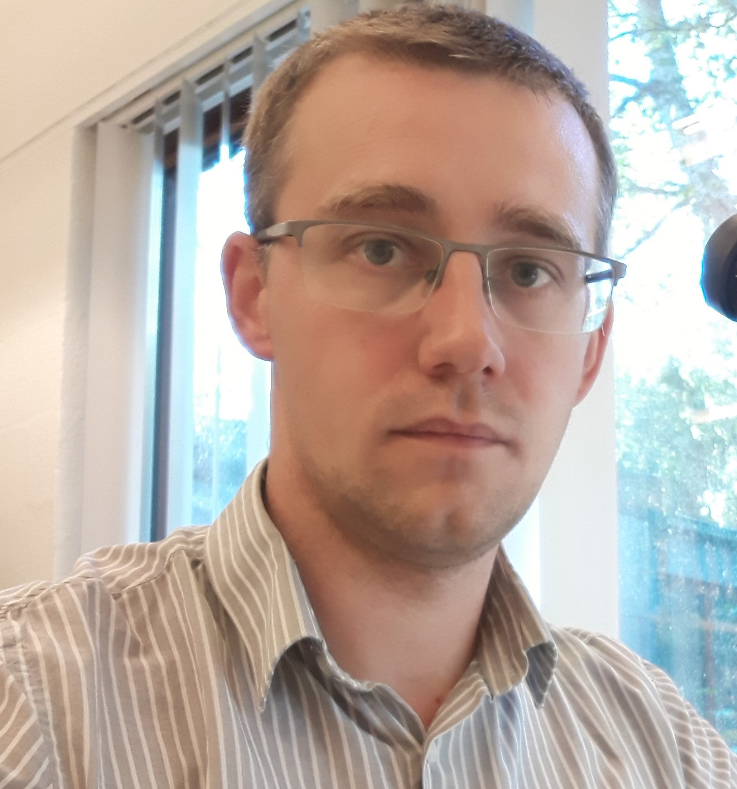

:::  {.panel}

:::: {.members}

::::: {.member}
:::::: {.member-photo}
{fig-alt="Jarosław Stolarski"}
::::::
:::::: {.member-body}
[Jarosław Stolarski]{.member-name}

[President · Warsaw, Poland]{.member-role}

Why corals form calcium carbonate skeleton at greatest ocean depths where calcium carbonate easily dissolves? Why do corals form the skeleton at all? Is the coral skeleton a climate or/and coral physiology archive? Why (and if) corals are masters of reef formation? More questions than answers. Corals are not "simple animals" and that's why I love them!
::::::
:::::

::::: {.member}
:::::: {.member-photo}
{fig-alt="Markus Aretz"}
::::::
:::::: {.member-body}
[Markus Aretz]{.member-name}

[Vice President · Toulouse, France]{.member-role}

I am a professor at the University of Toulouse (France), where I teach palaeontology, carbonate sedimentology and field geology. My research interests cover different aspects of the evolution of the geosphere and biosphere, with a focus on the upper Palaeozoic. This results in broad interests in fields like carbonate sedimentology, coral taxonomy, palaeobiology, palaeo(bio)geography, palaeodiversity, stratigraphy, and basin analysis. One of my long-time favourites are reef systems. In 2027, the next IFCRS symposium will be held in Toulouse. We are already excited to host our community in the Ville rose!
::::::
:::::

::::: {.member}
:::::: {.member-photo}
{fig-alt="Nadia Santodomingo"}
::::::
:::::: {.member-body}
[Nadia Santodomingo]{.member-name}

[Secretary · London, England]{.member-role}

I am a coral-reef scientist interested in the diversity, ecology and evolution of these highly diverse ecosystems. My main focus has been to improve our understanding of the origins and evolution of coral reefs on Earth. My investigations cover a broad spatial scale, with studies in the Caribbean and the Indo-Pacific (Coral Triangle) from shallow to deep-water habitats. My research involves also a broad temporal scale, as I develop multidisciplinary studies that link the history of ancient and modern reefs by using cutting-edge biogeographic, molecular and phylogenetic tools. By integrating fossils and modern coral taxa, I expect to obtain key information to predict how reefs are likely to respond to the current scenario of rapid climate change, and ultimately, to offer reliable advice to conservation agencies to protect these important ecosystems.
::::::
:::::

::::: {.member}
:::::: {.member-photo}
{fig-alt="Lewis Jones"}
::::::
:::::: {.member-body}
[Lewis Jones]{.member-name}

[Internet Officer · London, UK]{.member-role}

I am a Palaeobiologist at University College London, UK. My research focuses on understanding the drivers of temporal and spatial biodiversity patterns across various timescales. Primarily, my work focuses on scleractinian corals, reef systems, and other marine invertebrates. In my research, I use a range of computational techniques and integrate tools from various disciplines, including ecology and palaeoclimatology. I am currently investigating the drivers of marine biodiversity hotspots throughout the Cenozoic and reconstructing their evolutionary history.
::::::
:::::

::::: {.member}
:::::: {.member-photo}
{fig-alt="Danijela Dimitrijevic"}
::::::
:::::: {.member-body}
[Danijela Dimitrijevic]{.member-name}

[Early Career Researcher representative · Erlangen, Germany]{.member-role}

I am PhD candidate at FAU Erlangen-Nürnberg in Germany. I am interested in how reef communities, corals and their traits responded to global environmental disturbances such as mass extinctions and hyperthermal events on geological time scales to help predict the future of modern reefs. To answer these questions, I use large databases such as the Paleobiology Database ([PBDB](https://paleobiodb.org/#/)), PaleoReefs Database ([PARED](https://paleo-reefs.pal.uni-erlangen.de)), Ancient Reef Traits Database ([ART](https://cnidaria.nat.uni-erlangen.de/shiny/users/nussaibah/coralDB/?fbclid=IwAR2CH4jTV3If4L61IiohXC7KmQlkmSV_mv9LhJYRCiXRPMJj9UGN7U_y2iA/)), and R programming environment.
::::::
:::::

::::: {.member}
:::::: {.member-photo}
{fig-alt="Kun Liang"}
::::::
:::::: {.member-body}
[Kun Liang]{.member-name}

[Elected council member · Nanjing, China]{.member-role}

I am an associate professor in Nanjing Institute of Geology and Palaeontology, Chinese Academy of Sciences. I am fascinated for the palaeoecology and evolution of Palaeozoic corals and stromatoporoids, as well as reef-related organisms. My research has involved morphometrics to distinguish species and serial sectioning techniques to study the budding pattern and phylogeny of ancient corals. My recent topic concerns with integrative stratigraphy and evolution of Palaeozoic reefs in Tibet and adjacent regions.
::::::
:::::

::::: {.member}
:::::: {.member-photo}
{fig-alt="Angelina Ivkić"}
::::::
:::::: {.member-body}
[Angelina Ivkić]{.member-name}

[Elected council member · Vienna, Austria]{.member-role}

I am currently pursuing my PhD at the University of Vienna, focusing on the study of fossil corals from the last interglacial period. My research interest lies in using past periods characterized by higher temperatures to forecast potential trajectories for the future of coral reefs in the Red Sea. Moreover, I am passionate about science communication and involved in a project aimed at creating an engaging detective game centered around coral reefs for educational purposes. Within IFCRS, my primary responsibilities involve managing social media platforms.
::::::
:::::

::::: {.member}
:::::: {.member-photo}
{fig-alt="Thomas Stemann"}
::::::
:::::: {.member-body}
[Thomas Stemann]{.member-name}

[Elected council member · Mona, Jamaica]{.member-role}

I am a Lecturer in the Department of Geography and Geology at the University of the West Indies in Kingston Jamaica. My research chiefly focusses on patterns in Caribbean reef coral diversity and paleoecology from the Cretaceous through the Recent. This work has involved field work throughout the Caribbean and Central America and centred over the last 25 years on the rich fossil record in Jamaica.
::::::
:::::

::::: {.member}
:::::: {.member-photo}
{fig-alt="Julien Denayer"}
::::::
:::::: {.member-body}
[Julien Denayer]{.member-name}

[Elected council member · Liège, Belgium]{.member-role}

My main research focuses on Devonian and Carboniferous rugose corals, their evolution, palaeoecology, stratigraphy and palaeobiogeography. Moreover, I study their response to biotic crises, extinctions and recoveries, particularly in the Late Devonian. Working on corals also led me to be interested in the reefal environment and the development of reefs during the Devonian with a peculiar view on southern Belgium where Devonian reefs are so common and so beautiful. I also have a profound passion for regional and historical geology that provide a good context for the corals I study.
::::::
:::::

::::

:::