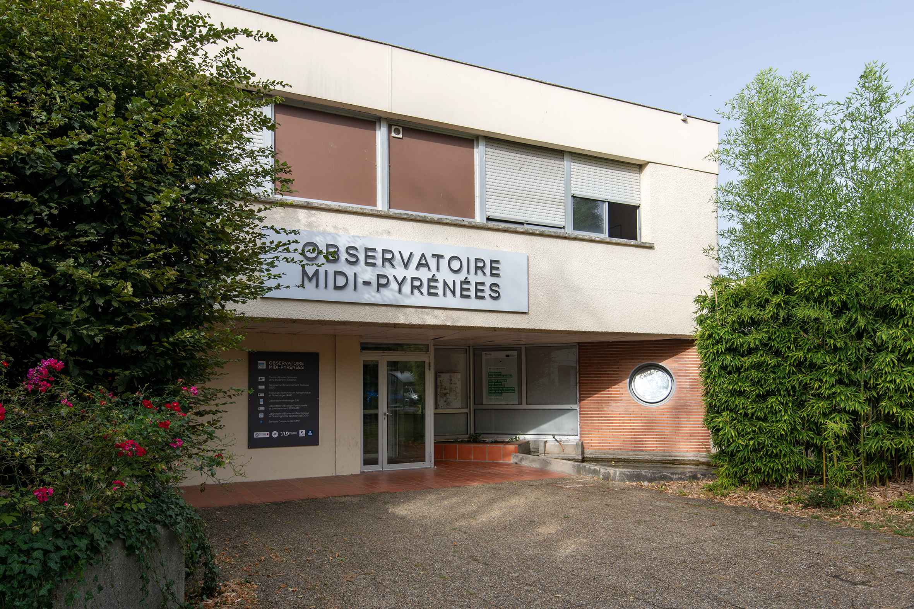
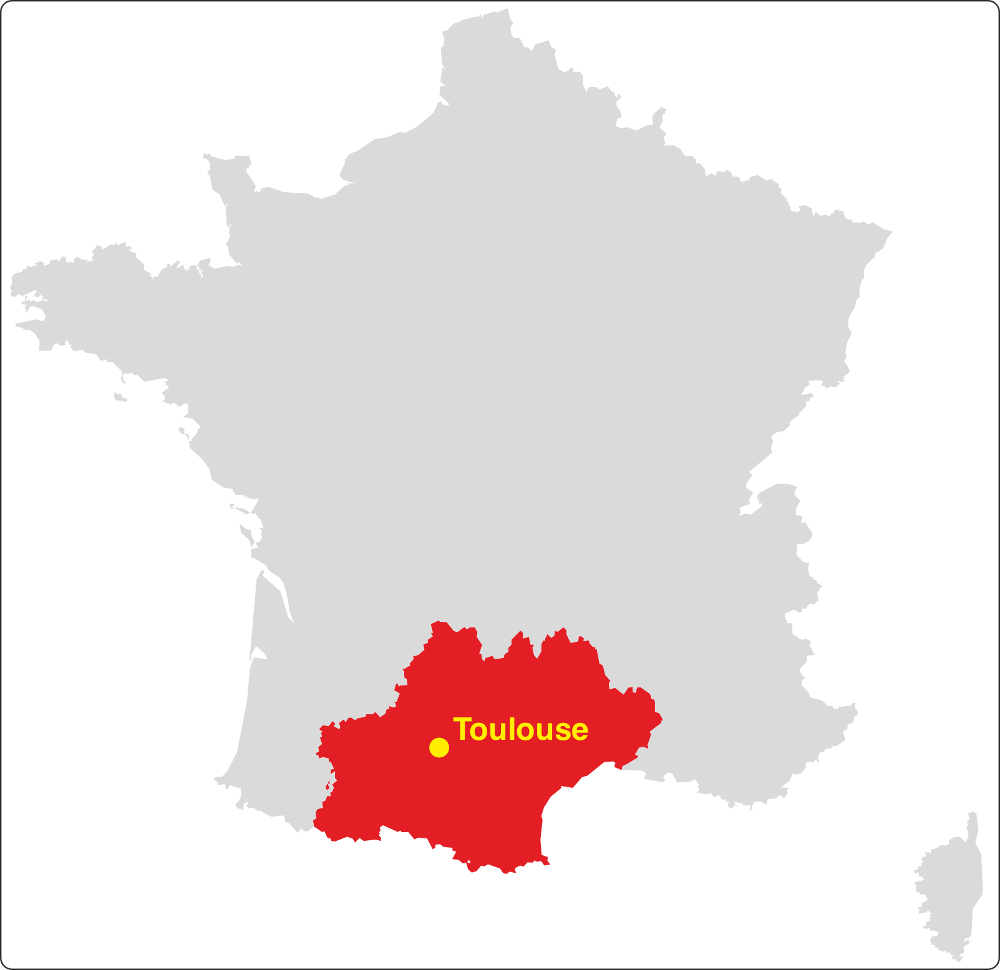
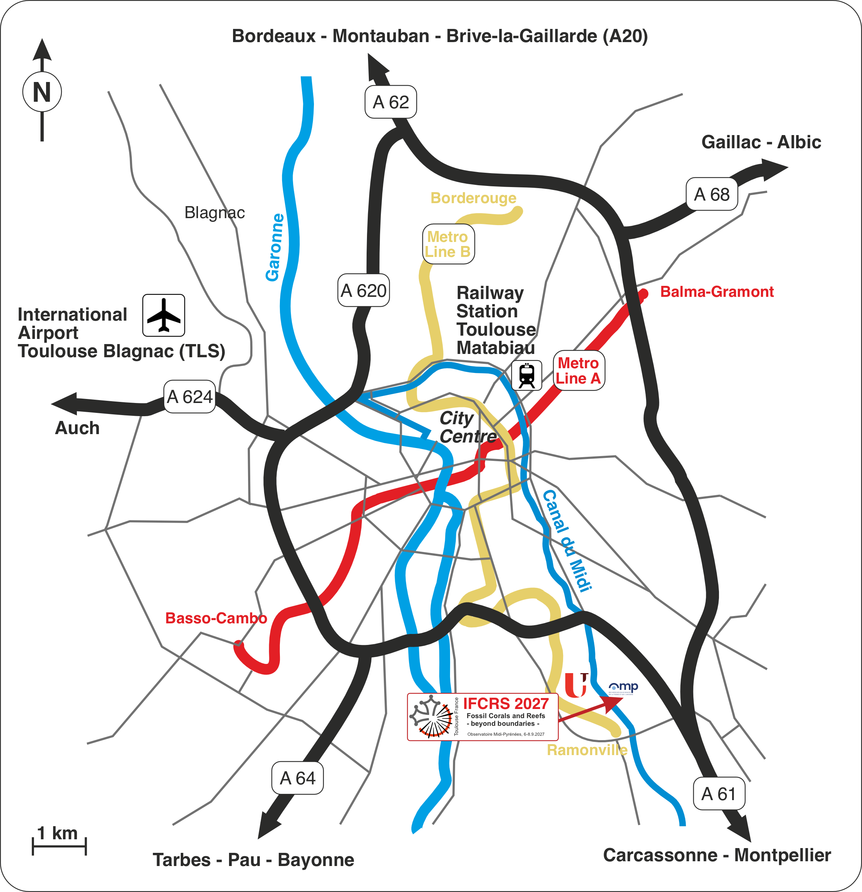
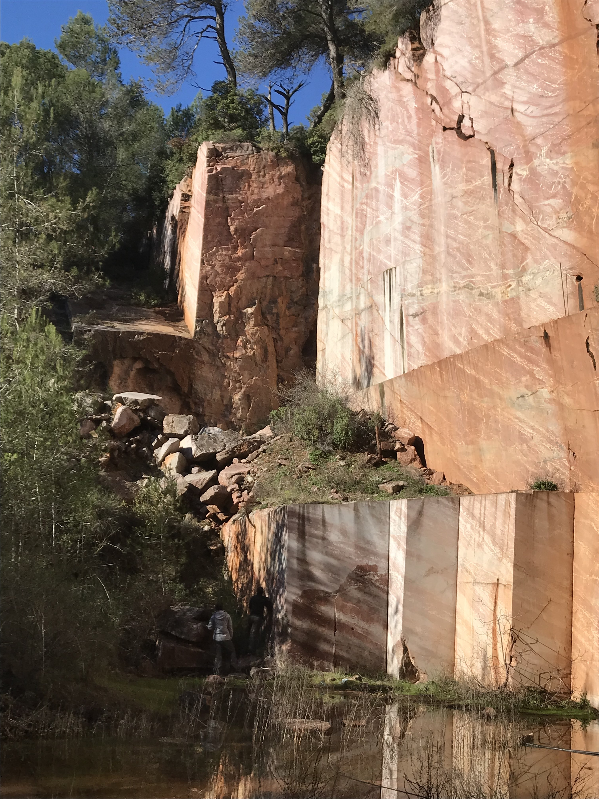
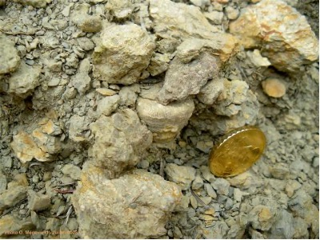
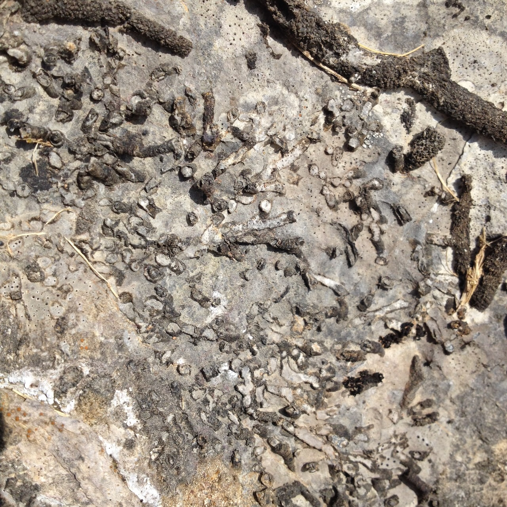
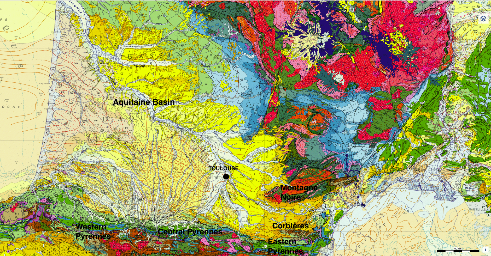

# Invitation from the host

We cordially invite you to attend the 15^th^ IFCRS Symposium – IFCRS 2027 “Fossil Corals and Reefs – beyond boundaries”, to be held from 6^th^ to 8^th^ September 2027 at the Observatoire Midi-Pyrénées, University of Toulouse (France).

We look forward to welcoming researchers from around the world back to France, about half a century after the 2^nd^ symposium of our society was organised at the Natural History Museum in Paris in 1975.

The scientific rationale for this symposium could hardly be timelier. Modern coral reefs are among the ecosystems most severely threatened by ongoing climatic change. Yet the observational record of these changes is distressingly short. Only the fossil record can provide the long-term baseline against which the magnitude and rate of present-day change can be measured. Reefs and coral communities of the geological past have already witnessed — and survived or succumbed to — episodes of rapid global warming, mass extinctions, oceanographic reorganisations, and biotic turnovers. 

Reading these archives, spanning hundreds of millions of years, is a very powerful tool for our understanding how modern reefs and coral ecosystems respond to environmental stress. However, these archives can be examined from various angles and with very different approaches. Thus, they provide valuable information for coral evolution and palaeoecology, biomineralisation, diversity trends, and palaeo(bio)geography to name just a few areas of research. 

The symposium will therefore bring together international experts to present and discuss the latest research on fossil reefs and coral ecosystems, including their diverse associated biota through time. 

We invite you to circulate this announcement among colleagues and students who may wish to attend.

We look forward to welcoming you to Toulouse.

On behalf of the organisers

Markus ARETZ  
-Chair of IFCRS 2027-

# Symposium timetable

| Date | Event |
|---|---|
| September 4–5^th^ 2027 | Pre-symposium field trips: Montagne Noire and Corbières |
| September 5^th^ 2027 | Ice-breaker party in the evening (in the city centre) |
| September 6–8^th^ 2027 | Scientific symposia at the Observatoire Midi-Pyrénées |
| September 7^th^ 2027 | Gala Dinner |
| September 9–10^th^ 2027 | Post-symposium field trip to the Aquitaine Basin |

# Important dates

- **Website launch:** December 1^st^, 2026 
- **Second circular:** mid-January 2027
- **Abstract submission opens:** 1^st^ March, 2027
- **Registration opens:** 1^st^ February, 2027
- **Deadline for early bird registration:** 1^st^ June, 2027
- **Deadline for abstract submission:** 1^st^ June, 2027
- **Notification oral and poster communication:** 15^th^ June, 2027
- **Dispatch of third circular:** 1^st^ July, 2027
- **Publication of final scientific programme:** 1^st^ August, 2027

# Symposium venue

The symposium will take place at the Observatoire Midi-Pyrénées, which is situated in the ‘complexe scientifique’ next to the main campus of the University of Toulouse (Paul Sabatier campus) in the Rangueil district. Most of the activities will take place in and around the Salle de Coriolis, including the registration desk, scientific sessions, poster presentations, coffee and lunch breaks. We have also access to additional rooms in the buildings to organise dedicated workshops or meetings.

```{r}
#| label: map
#| echo: false

library(leaflet)
library(htmltools)

map <- leaflet(width = "100%", height = 400) |>
  addTiles() |>
  setView(lng = 1.479537, lat = 43.562586, zoom = 15) |>
  addMarkers(
    lng = 1.479537, lat = 43.562586,
    popup = "Observatoire Midi-Pyrénées<br>14 Av. Edouard Belin, 31400 Toulouse, France"
  )

div(style = "width: 50%; margin-left: auto; margin-right: auto;", map)
```

The venue is well connected to public transport via several bus lines (L7, 27, 78, 80) and the metro line B. Overall travel time from the city centre is 25--30 min. Free parking is available for those coming by car. 

{.center-img width="50%"}

# General information about Toulouse

Toulouse is the 4^th^ largest French city, located in the heart of southwestern France. The city is ideally situated halfway between the Pyrenees Mountains, the Atlantic Ocean and the Mediterranean Sea. Toulouse is crossed by the Garonne River and the charming Canal du Midi. This city tingles your spine with a Latin heat, reflected in both its temperature and distinctive architecture. 

The city charms visitors with its narrow sinuous streets and diverse architecture, from medieval to modern monuments, such as the City Hall and its Donjon (XVIth century), or the numerous noble mansions (XVIth-XIXth centuries). Toulouse is a cosmopolitan and vibrant town, combining historical heritage and modern lifestyle. Gastronomic specialities include the famous ‘saucisse de Toulouse’, the ‘Cassoulet’, and the delicate ‘foie gras’. The university, founded in 1229, is the third largest in France and one of the oldest in Europe. 

You can find much useful information on the [website of the Tourist Office](https://www.toulouse-tourisme.com/en/).

{.center-img width="50%"}

{.center-img width="50%"}

# Useful information

## How to get to Toulouse

Toulouse is situated between the Mediterranean Sea in the East, the Atlantic Ocean in the West, the Pyrenees in the South and the Massif Central in the North, just in the heart of the Occitanie region.

{.center-img width="50%"}

Toulouse can be easily reached by car (Motorways A61, A62, A64, A68), train (Toulouse Matabiau station) and airplane (Airport Toulouse Blagnac, TLS).

{.center-img width="50%"}

### Toulouse-Blagnac International Airport

[Toulouse-Blagnac international airport](https://www.toulouse.aeroport.fr) is situated at about 8 km northwest of Toulouse. The city centre is easily reached by airport shuttle service, [public transport](http://www.tisseo.fr/) service (tramline T2, bus) or by taxi (taxi rank outside the arrivals hall). You can also hire a car from one of the many rental car companies at the airport or at the train station.

### Toulouse Matabiau Train Station

[Matabiau SNCF railway station](https://www.ter.sncf.com/occitanie/se-deplacer/gares/toulouse-matabiau-87611004) is in the city centre ([voyage-sncf](https://www.sncf-connect.com) or [tgv-europe](https://www.sncf-connect.com/en-en/tgv?esl-k=google-ads%7Cng%7Cc576717754796%7Cmb%7Cktgv%20europe%7Cp%7Ct%7Cdc%7Ca135138474400%7Cg15986526684&gclsrc=aw.ds&&prex=SEA&gad_source=1&gad_campaignid=15986526684&gbraid=0AAAAAD3I9uafxvyauyY584JApOdCwwvVv&gclid=Cj0KCQiAnsvXBhCqARIsAHKgGNaXlA3QEcobSkfo3Ha5eaajowfHga2Y1uKJSb0QaknhXWbpH6G2Z9saAg2SEALw_wcB)).

Please find more information on the website of the [tourist office of Toulouse](https://www.toulouse-tourisme.com/en/).

## Visas and Invitation Letters

Please check if your visit to France will require a visa. On request, we will provide official invitation letters to delegates who need to apply for a visa.

## Where to sleep? 

Toulouse offers a diverse range of stylish hotels, comfortable vacation apartments, guesthouses, and youth hostels. Prices for suitable accommodations start at 55 €/night.

We suggest you choose a hotel in the city centre, close to the metro line B. It will take you 15 to 20 min to reach the symposium venue by metro. 

You can also find a large list on the [website of the Tourist Office](https://www.toulouse-tourisme.com/en/prepare-for-your-stay/accommodation/): 

- [two-star hotels](https://www.toulouse-tourisme.com/hotels#path=categorieshebergement/2+%C3%A9toiles)
- [three-star hotels](https://www.toulouse-tourisme.com/hotels#path=categorieshebergement/3+%C3%A9toiles)
- [four-star hotels](https://www.toulouse-tourisme.com/hotels#path=categorieshebergement/4+%C3%A9toiles)

## Where to eat? 

Lunch will be provided at the symposium venue (included in the registration fees). 

For your evening meal, participants will find a diverse range of restaurants in the city centre and the suburbs. They serve everything from local and regional dishes, French cuisine to international food styles. There should be something for every taste and also budget. 

The website of the Tourist Office provides a [long list of possibilities](https://www.toulouse-tourisme.com/en/eat-and-drink/), but there is still much more. Just walk around and try to find your place to eat; around the Carmes and Victor Hugo Markets you will find a lot of restaurants using the fresh market products.    

## Pub and restaurant suggestions

Lively squares with pubs and restaurants:

- Capitole Square – The heart of Toulouse and its largest square, full of terraces and beautiful view on the Capitole.
- Saint-Georges Square – A charming and lively little square surrounded by bars and restaurants.
- Saint-Pierre Square – A student favorite, with a buzzing atmosphere, especially at night.
- La Daurade (Daurade Haven) – A scenic spot on the Garonne river, perfect for an evening drink.

Recommended Pubs for Beer and Wine Lovers:

- Bistrot 12 (St-Cyprien quarter) – A great selection of wines on the rive gauche!
- Grave – A classy wine bar right next to the Garonne.
- Les Tilleuls – Known for its big terrace under beautiful linden trees. Offers beer, cocktails, and music.
- La Houblonière – A cozy place for craft beers, cheese, and charcuterie.
- L’Astronef – A friendly community and cultural café not far from the university.
- Breughel l’Ancien – Traditional beer hall near the lively Arnaud Bernard district.
- The Dubliners – Irish-style pub a bit outside the city centre, but worth a visit.
- Rooster & Beer – Excellent French craft beers, close to the Matabiau train station.
- Thirsty Monk – A wide selection of whiskeys and beers in the heart of the city.
- Hopscotch Pub & Brewery – Another solid pick for whiskey and beer enthusiasts.
- Boudu Pont - a friendly cultural and community bar on the less crowded “rive gauche” (St Cyprien Quarter).

# Sessions 

Details coming soon...

# Programme (July 2027)

Details coming soon...

# Presenter guidelines (June 2027)

**The official language of the symposium will be English and no translation facilities will be available.**

## Instructions for Orals

- **Each talk slot will be 20 minutes. Each presentation is limited to 15 minutes plus 5 minutes for questions.** Please, prepare your presentation in a PowerPoint (ppt, pptx) or a PDF format. The presentation will be displayed on screen by video projector. Each session room will be equipped with a computer with MS PowerPoint, VLC, and Adobe Acrobat Reader (.ppt, .pptx or .pdf format files + video files .avi), a digital projector, a laser pointer, and microphone. You will not be able to use your own computer.
- The file upload will be done in the room. **The upload must be done well in advance**, at the latest during the break before the beginning of the session.
- An operator will be available to assist. 
- Please, prepare the file of your oral presentation named **“Lastname_firstname.ppt(x)/pdf”**.

## Instructions for Posters

The Poster Session will be located in the Salle de Coriolis.
- **Posters will be displayed during the entire symposium.**
- The poster sessions coincide with coffee and lunch breaks and also a special poster session at the end of each day.
- The posters will be mounted on vertical panels and must be **prepared in a portrait layout.**
- The poster board usable space will be suitable for an **A0 paper size in portrait layout** (up to 118cm height and 84cm width).
- Authors are responsible for the setup of their poster. Authors are responsible for dismantling their poster at the end of the symposium.
- Material for mounting the poster on the boards will be provided at the registration desk.

# Field trips 

We are currently working on the detailed programmes for two field trips, each illustrating the fossil coral and reef localities in the SW of France.

```{=html}
<style>
.fixed-height img {
  height: 200px;
  width: 100%;
  object-fit: cover;
}
</style>
```

::: {.fixed-height layout-ncol=3}





:::

- Pre-symposium field trip (2 days): Cambrian to Eocene reefs and corals in the Montagne Noire and Corbières 
- Post-symposium field trip (2 days): Mesozoic and Cenozoic reefs and corals of the Aquitaine Basin

{.center-img width="75%"}

# Social events

- Ice-breaker party: Sunday, 5 September 2027
- Gala Dinner: Tuesday, 7 September 2027

# Registration and fees 

Registration will start on 1^st^ February 2027. The registration fee will include on-site lunches for all three days of the symposium, as well as the Gala Diner. We aim to keep the registration as low as possible. The anticipated fees for early-bird registration are 250€ for full delegates and 150€ for students. The anticipated fee for a field trip is 240€ for double-room occupation, transport, and meals.

# Circulars

- [First Circular](ifcrs-2027-1st-circular.pdf)

# Partners and sponsors

- Université de Toulouse: [https://utoulouse.fr](www.utoulouse.fr)
- Observatoire Midi-Pyrénées: [https://www.omp.eu](www.omp.eu)
- Géosciences Environnement Toulouse: [https://www.get.omp.eu](www.get.omp.eu)

# Organisers 

**Chair:** Markus Aretz

**Local Committee Members:** Frédéric Christophoul, Guillaume Dera, Marc De Rafélis, Élise Nardin, Delphine Rouby  
**Scientific Committee Members:** Francesca Bosellini, Bernard Lathuilière, Raphaël Vasseur and the IFCRS council members

# Contact

Markus Aretz, [ifcrs2027@ifcrs.org](mailto:ifcrs2027@ifcrs.org)
