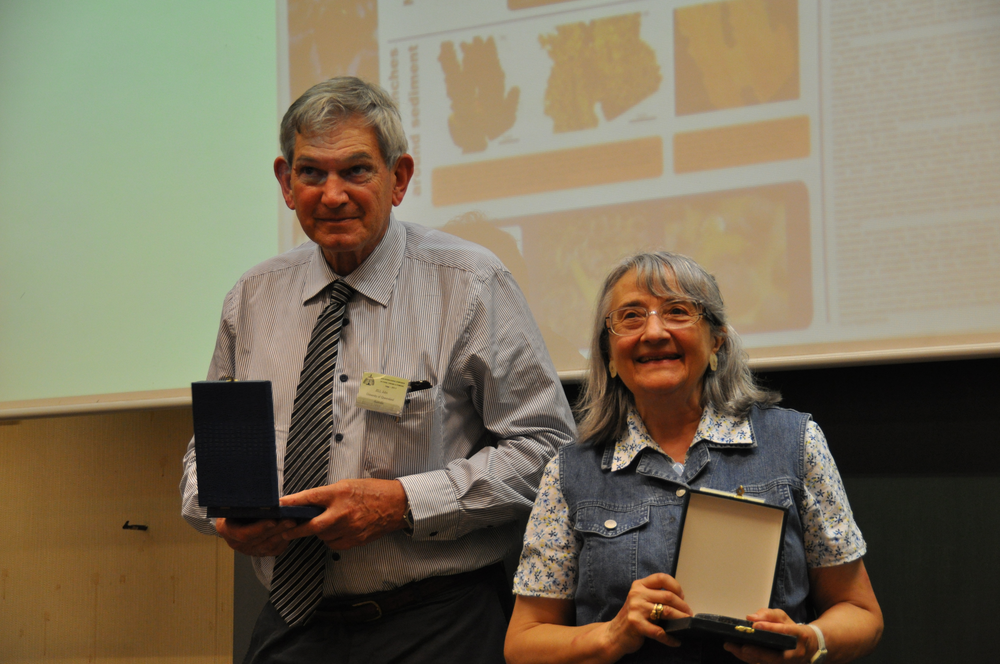
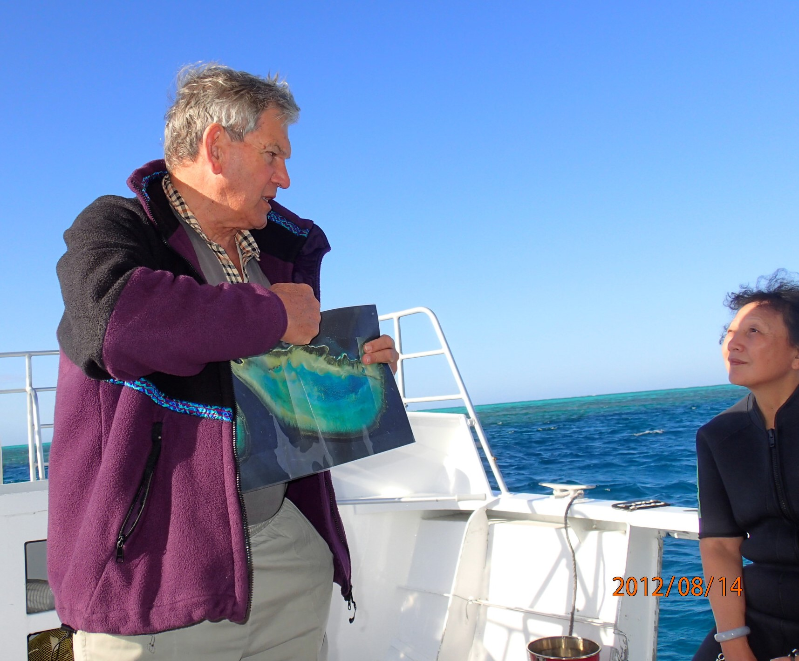

It is our sad duty to report the passing of Prof. John S. Jell (Brisbane, Australia) on 7 October 2026. John received our Society's Milne-Edwards Medal in recognition of his contributions and achievements to research on fossil and recent corals and reefs in 2011. John was a long-standing member of our society, and typical for him became engaged whenever a helping hand was needed. In 1988 he was co-organiser of the 5th Symposium of the Society in Brisbane. 
 
John's longstanding association with the University of Queensland (Brisbane) began as a first-year Bachelor student in 1957, and by his third year he begun his 60-year teaching career at UQ. Dorothy Hill, one of the world's leading fossil coral scientists of the 20th century, was his PhD supervisor. Dorothy had taken John already under her wing before he started his PhD project, and this set the foundation for a very fruitful and lasting collaboration. John later became the inaugural recipient of the Geological Society of Australia Queensland Division's Dorothy Hill Medal (2002). 

{.center-img width="50%"}
 
John was a highly respected geologist and reef scientist whose research made significant contributions to our understanding of corals and the Great Barrier Reef. He had a particularly enduring connection with Heron Island Research Station, where he worked for some 50 years, investigating coral growth and microstructure, as well as the geology, development and distribution of reefs across the Great Barrier Reef. In his own words, Heron Island became a second home for him and his family. 
 
He was also internationally recognised as a world leader in the study of ancient corals and reefs, especially rugose corals, making significant contributions to palaeontology and our understanding of coral microstructure and evolution through geological time. This is well illustrated by an impressive publication record through all geological periods, starting from the earliest cnidarians to modern corals. 
 
John was equally committed to education and to sharing his knowledge. He taught generations of UQ students, led field courses at Heron Reef and in the Australian bush, and organised countless Great Barrier Reef visits and courses for other universities, schools, researchers and conferences. 

{.center-img width="50%"}

In 2021, John was appointed a Member of the Order of Australia (AM) for significant service to environmental science education and geological societies, a fitting recognition of his contribution over many decades.
 
John is survived by his three beloved daughters and their families, as well as his brother, Dr. Peter Jell, also an eminent palaeontologist in Australia. John's passing also represents a significant loss to UQ and the wider geological and coral reef science communities. His legacy lives on through his research, his contributions to our understanding of the Great Barrier Reef, and, perhaps most importantly, through the many students and colleagues who benefited from his knowledge, generosity and commitment to science and education.